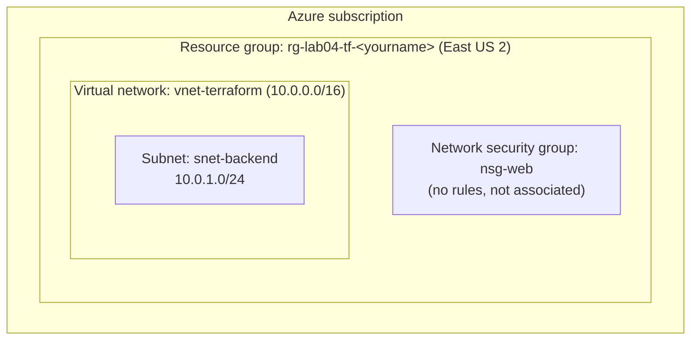
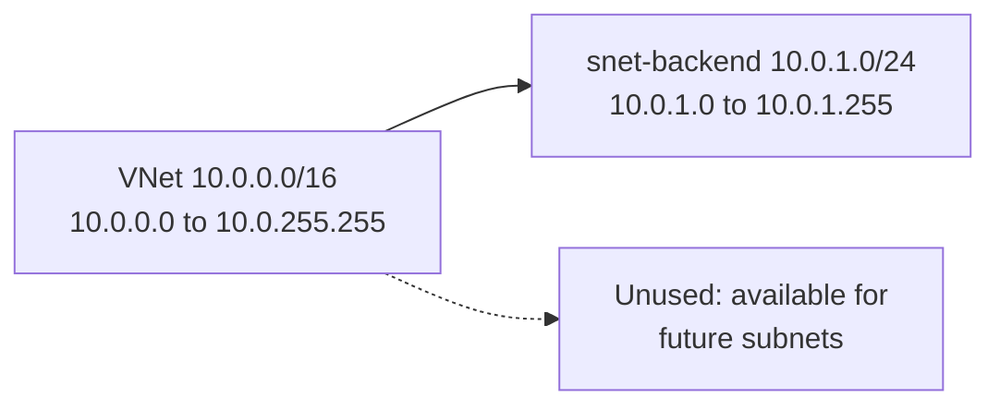
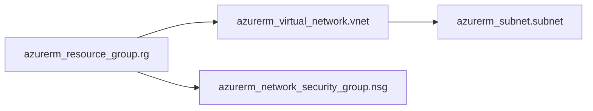
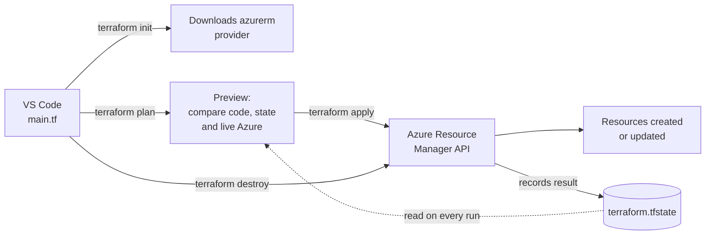
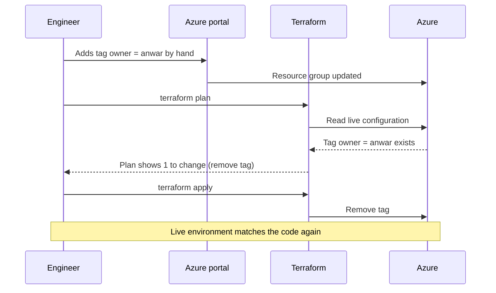

 ### Infrastructure as Code with Terraform on Azure

Build, change and tear down an Azure network from a single Terraform file, without creating anything by hand in the Azure portal.

| | |
|---|---|
| **Cloud** | Microsoft Azure |
| **Tool** | Terraform 1.x, `azurerm` provider 3.x |
| **Resources** | Resource group, virtual network, subnet, network security group |
| **Time** | About 30 minutes after setup |
| **Cost** | $0. None of these resources bill on their own. |

---

## Contents

1. [What you will build](#what-you-will-build)
2. [Architecture](#architecture)
3. [Prerequisites](#prerequisites)
4. [Repository layout](#repository-layout)
5. [Step-by-step deployment](#step-by-step-deployment)
6. [Making a change to a live environment](#making-a-change-to-a-live-environment)
7. [Detecting drift](#detecting-drift)
8. [Tearing it down](#tearing-it-down)
9. [Troubleshooting](#troubleshooting)
10. [Key concepts](#key-concepts)
11. [Next steps](#next-steps)

---

## What you will build

| Resource | Name | Purpose |
|---|---|---|
| Resource group | `rg-lab04-tf-<yourname>` | Container that holds every other resource |
| Virtual network | `vnet-terraform` | Private network with address space `10.0.0.0/16` |
| Subnet | `snet-backend` | Network segment `10.0.1.0/24` inside the VNet |
| Network security group | `nsg-web` | Firewall rule set, added later to show an incremental change |

All four are defined in [`main.tf`](./main.tf) and deployed to **East US 2**.

---

## Architecture

### Azure resources

What exists in Azure after a full deployment.



> The NSG sits in the same resource group but is **not attached** to the subnet. Attaching it is listed under [Next steps](#next-steps).

### Address space

The subnet uses 256 of the VNet's 65,536 addresses, which leaves room for more subnets later.



### Dependency graph

Terraform reads the references between resources and works out the build order itself. Destroy runs in reverse.



For example, the VNet sets `resource_group_name = azurerm_resource_group.rg.name`. That reference is what tells Terraform to create the resource group first.

### Deployment workflow

How your machine, Terraform and Azure interact.



---

## Prerequisites

These instructions are for **macOS**. Windows users can install the same tools with `winget`.

| Tool | Install | Check |
|---|---|---|
| Homebrew | See [brew.sh](https://brew.sh) | `brew --version` |
| Terraform | `brew tap hashicorp/tap && brew install hashicorp/tap/terraform` | `terraform -version` |
| Azure CLI | `brew install azure-cli` | `az version` |
| VS Code | `brew install --cask visual-studio-code` | Opens from Applications |
| HashiCorp Terraform extension | VS Code > Extensions > search "HashiCorp Terraform" | Syntax colouring in `.tf` files |

You also need an **Azure subscription**. An Azure for Students subscription works; read [Troubleshooting](#troubleshooting) first, because it has region restrictions.

> `az version` may print a `SyntaxWarning` from the CLI's own Python files. It is harmless and can be ignored.

---

## Repository layout

```text
lab04-terraform/
├── main.tf               # All infrastructure for this lab
├── .gitignore            # Keeps state files and provider binaries out of Git
├── .terraform.lock.hcl   # Created by terraform init; pins the provider version (commit this)
└── README.md             # This file
```

Created locally but **never committed**: `.terraform/` (provider binaries) and `terraform.tfstate` (contains your subscription details).

---

## Step-by-step deployment

Run every command in the VS Code terminal (**Ctrl + `**), from the project folder.

### 1. Sign in to Azure

```bash
az login
```

A browser window opens. Sign in, then pick your subscription when prompted. Confirm it:

```bash
az account show --query name -o tsv
```

**Expected:** your subscription name, for example `Azure for Students`.

### 2. Check which regions you can use

Some subscriptions only allow certain regions. Check before you deploy:

```bash
az policy assignment list --query "[].parameters.listOfAllowedLocations.value" -o json
```

- **A list of regions appears:** make sure the `location` in `main.tf` is one of them.
- **`[]` or nothing appears:** there is no region restriction.

### 3. Register the network provider (one time only)

`main.tf` turns off Terraform's automatic provider registration, so register the one this lab needs:

```bash
az provider register --namespace Microsoft.Network --wait
```

**Expected:** the prompt returns with no output.

### 4. Set your resource group name

Open `main.tf` and change `anwar` to your own first name, lowercase with no spaces:

```hcl
name = "rg-lab04-tf-yourname"
```

Save with **Cmd + S**.

> To match the lab's later phases exactly, remove the `azurerm_network_security_group` block for now and add it back in [Making a change](#making-a-change-to-a-live-environment).

### 5. Initialize

```bash
terraform init
```

**Expected:** `Terraform has been successfully initialized!`
This downloads the `azurerm` provider into `.terraform/` and creates `.terraform.lock.hcl`.

### 6. Preview

```bash
terraform plan
```

**Expected:** `Plan: 3 to add, 0 to change, 0 to destroy.`
Nothing is created at this stage. Read the plan before you continue.

### 7. Deploy

```bash
terraform apply
```

Type the full word `yes` when prompted. `y` is not accepted.

**Expected:** `Apply complete! Resources: 3 added, 0 changed, 0 destroyed.`
Terraform creates the resource group, then the VNet, then the subnet, in dependency order.

### 8. Verify

```bash
terraform state list
```

**Expected:**

```text
azurerm_resource_group.rg
azurerm_subnet.subnet
azurerm_virtual_network.vnet
```

Confirm in Azure itself:

```bash
az network vnet subnet show \
  --resource-group rg-lab04-tf-yourname \
  --vnet-name vnet-terraform \
  --name snet-backend \
  --query addressPrefix -o tsv
```

**Expected:** `10.0.1.0/24`

---

## Making a change to a live environment

This shows Terraform changing only what is different.

1. Add this block to the bottom of `main.tf` and save:

   ```hcl
   resource "azurerm_network_security_group" "nsg" {
     name                = "nsg-web"
     location            = azurerm_resource_group.rg.location
     resource_group_name = azurerm_resource_group.rg.name
   }
   ```

2. Preview:

   ```bash
   terraform plan
   ```

   **Expected:** `Plan: 1 to add, 0 to change, 0 to destroy.`
   Terraform compares the file with its state, sees the other three resources are unchanged, and plans only the NSG.

3. Apply and type `yes`:

   ```bash
   terraform apply
   ```

   **Expected:** `Apply complete! Resources: 1 added, 0 changed, 0 destroyed.`

---

## Detecting drift

*Optional extension, not part of the original lab.* Drift is when the live environment no longer matches the code, usually because someone changed it by hand.



1. In the Azure portal, open your resource group > **Tags**, add `owner` = `yourname`, and click **Apply**.
2. Run `terraform plan`. **Expected:** `Plan: 0 to add, 1 to change, 0 to destroy`, with the tag marked for removal.
3. Decide:
   - **The change wasn't approved:** run `terraform apply` to revert it.
   - **The change was needed:** add it to `main.tf` (for example, a `tags = { owner = "yourname" }` argument) so it is reviewed and tracked.

---

## Tearing it down

```bash
terraform destroy
```

Type `yes` when prompted.

**Expected:** `Destroy complete! Resources: 4 destroyed.` (3 if you skipped the NSG.)

Confirm nothing is left:

```bash
az group exists --name rg-lab04-tf-yourname
```

**Expected:** `false`

> **Always use `terraform destroy`, not the portal.** Deleting resources in the portal leaves `terraform.tfstate` out of date, and Terraform will plan to recreate them on the next run.

> A resource group called `NetworkWatcherRG` may remain. Azure creates it automatically when you deploy a network. It is free and safe to leave.

**Rebuild at any time:** `main.tf` is the full definition, so `terraform apply` recreates the environment in about two minutes.

---

## Troubleshooting

| Symptom | Cause | Fix |
|---|---|---|
| `terraform plan` prints nothing for several minutes | The provider is registering every Azure resource provider and has stalled (often on `Microsoft.AVS`) | Press **Ctrl + C**. Keep `skip_provider_registration = true` in the provider block and run step 3. |
| `403 Forbidden` with `RequestDisallowedByAzure` when creating the VNet | Your subscription has a policy limiting which regions you can use | Run step 2, pick an allowed region and change `location` in `main.tf`. Plan will show the resource group being replaced, which is expected. |
| Red underline on `skip_provider_registration` in VS Code | The editor is checking against `azurerm` 4.x, where the setting was renamed | Cosmetic only. `terraform plan` is the real check. In 4.x, use `resource_provider_registrations = "none"` instead. |
| `Resource group already exists` | A resource group with that name exists from an earlier attempt | Delete it with `az group delete --name <name> --yes`, or change the name in `main.tf`. |
| `az: command not found` | Azure CLI not installed, or the terminal opened before installation | Run `brew install azure-cli`, then open a new terminal. |
| `Error: building account` or authentication errors | Not signed in, or the token expired | Run `az login` again. |
| `Plan: 0 to add` when you expected changes | Terraform state already records those resources | Expected if they exist. Run `terraform destroy` first to start fresh. |
| Files and state vanish between sessions | You ran the lab in **Azure Cloud Shell**, whose storage can be ephemeral | Run from VS Code on your own machine, as this guide does. |

---

## Key concepts

| Concept | In one sentence |
|---|---|
| **Declarative** | You describe the end result; Terraform works out the steps. |
| **Provider** | The plugin (`azurerm`) that translates Terraform code into Azure API calls. |
| **State** | `terraform.tfstate` is Terraform's record of what it built; it compares against this on every run. |
| **Plan** | A read-only preview of exactly what will change. Always run it before `apply`. |
| **Implicit dependency** | When one resource references another, Terraform builds them in the right order automatically. |
| **Drift** | The live environment differs from the code, usually because of a manual change. |

---

## Next steps

Ways to extend this lab towards a production-style setup:

1. **Attach the NSG to the subnet** with `azurerm_subnet_network_security_group_association`, and add inbound rules.
2. **Use variables** (`variables.tf`) for the name and region, so one codebase can deploy dev and prod.
3. **Add outputs** (`outputs.tf`) to print the VNet and subnet IDs after apply.
4. **Store state remotely** in an Azure Storage account so a team can share it safely.
5. **Automate with GitHub Actions** to run `terraform plan` on every pull request.

---

*Author: Anwar Ahmed ·
